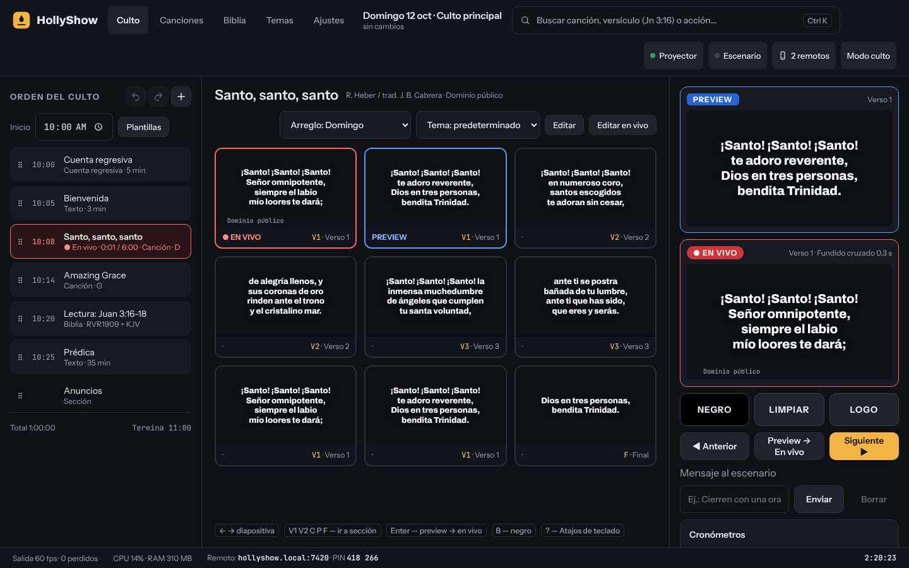
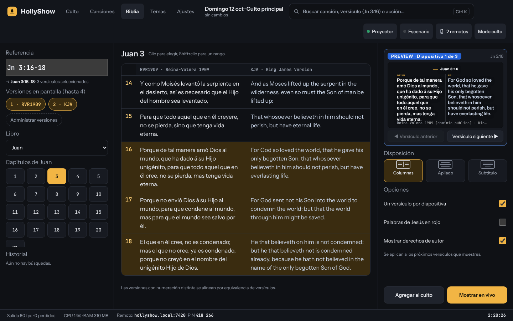
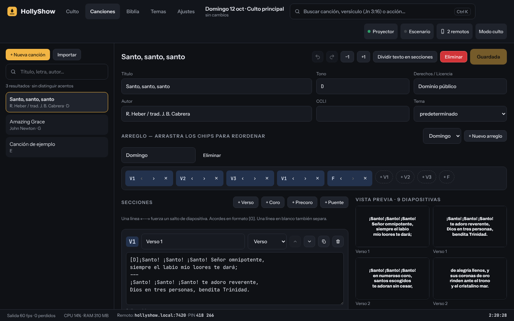
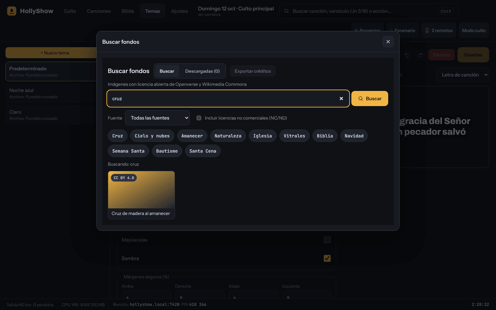
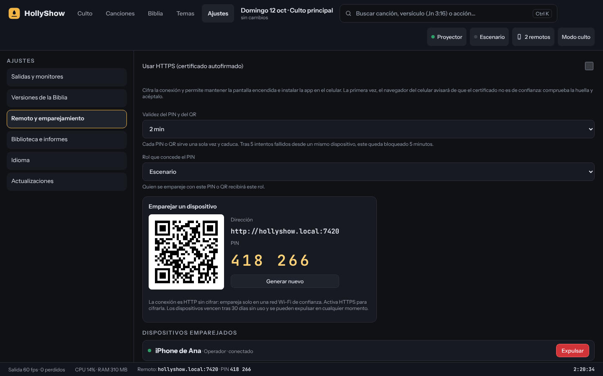
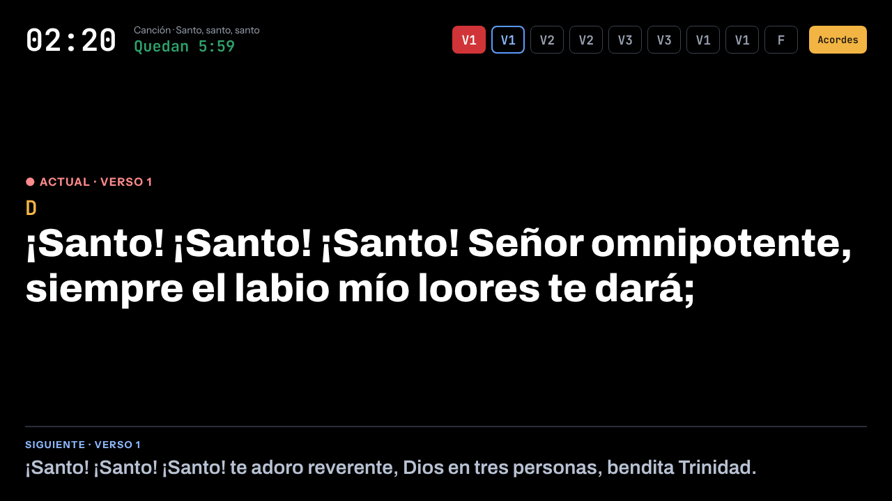
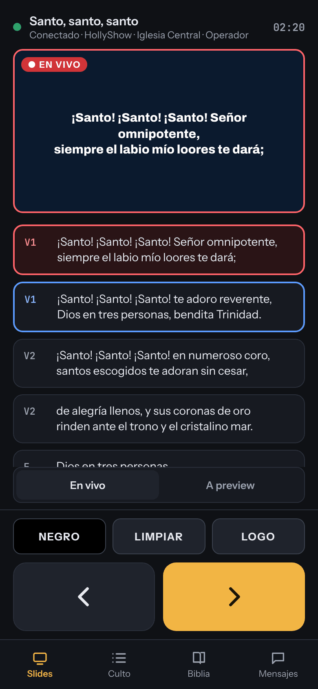
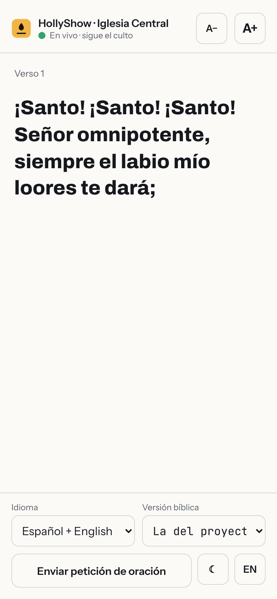

# HollyShow

Aplicación de escritorio para proyectar los cultos de una iglesia: canciones, Biblia, medios y anuncios,
con control remoto desde el móvil por la red local. Hecha con Tauri 2, React y Rust (versión 0.1.0).

## Qué incluye

- Biblioteca de canciones con búsqueda de texto completo (SQLite FTS5), acordes y transposición.
- Varias versiones de la Biblia de dominio público, búsqueda por referencia o por texto.
- Orden del culto con plantillas, modo culto (bloquea cierres accidentales), temporizadores y edición en vivo.
- Varias salidas (proyector, escenario) y temas configurables; paleta de comandos con Ctrl/Cmd+K.
- Control remoto web para móvil con emparejamiento por código; desactivado por defecto.
- Copias de seguridad automáticas, exportación e importación de la biblioteca, interfaz en español (inglés secundario).

Fuera de alcance por ahora: subtítulos con IA, NDI, MIDI/OSC, iluminación, Planning Center, sincronización en la nube.

## Capturas

Capturas de la interfaz con el contenido de demostración (dominio público). Se regeneran con `pnpm screenshots`.

|                  Operador: culto en vivo                  |                              Biblia multiversión                              |
| :-------------------------------------------------------: | :---------------------------------------------------------------------------: |
|  |  |

|                                Editor de canciones                                 |                                    Buscar fondos                                     |
| :--------------------------------------------------------------------------------: | :----------------------------------------------------------------------------------: |
|  |  |

|                           Ajustes: remoto y emparejamiento                            |                         Salida del proyector                         |
| :-----------------------------------------------------------------------------------: | :------------------------------------------------------------------: |
|  |  |

|                                 Pantalla de escenario                                 |                                    Remoto móvil: operador                                    |                                        Remoto móvil: congregación                                        |
| :-----------------------------------------------------------------------------------: | :------------------------------------------------------------------------------------------: | :------------------------------------------------------------------------------------------------------: |
|  |  |  |

## Requisitos

Rust estable, Node 22, pnpm 10, y las dependencias de Tauri 2 de tu SO
(Linux: `libwebkit2gtk-4.1-dev libgtk-3-dev librsvg2-dev libayatana-appindicator3-dev`).

## Desarrollo

```sh
pnpm bootstrap      # primera vez en un clon: instala y construye los frontends (los crates los incrustan)
pnpm dev            # app de escritorio (Tauri + Vite)
pnpm dev:web        # solo UI en el navegador con datos de demostración
pnpm dev:remote     # app remota móvil
pnpm screenshots    # regenera docs/screenshots (usa Chromium; CHROMIUM_PATH si no está en la ruta por defecto)
pnpm gen:types      # regenera los tipos TS desde Rust (ts-rs); commitea packages/protocol/src/generated
pnpm check:version  # Cargo.toml, package.json y tag coherentes (el release lo exige)
pnpm lint && pnpm typecheck && pnpm test
cargo fmt --all && cargo clippy --workspace --all-targets -- -D warnings && cargo test --workspace
pnpm build          # instaladores del SO actual (Linux: .deb y .AppImage en target/release/bundle)
```

## Compilar

```sh
pnpm install --frozen-lockfile
pnpm --filter remote build        # primero: el servidor Rust incrusta apps/remote/dist
pnpm --filter desktop tauri build # instaladores del SO actual en target/release/bundle
```

Linux produce `.deb` y `.AppImage`; macOS `.dmg`; Windows `.msi` y `.exe` (NSIS).

## Lanzamiento

La versión (0.1.0) debe coincidir en `Cargo.toml`, los `package.json` y la etiqueta (`pnpm check:version`).
Al subir una etiqueta `v*` (o ejecutar el workflow a mano) `.github/workflows/release.yml` pasa la verificación y compila con
`tauri-action` macOS universal (`.dmg`), Windows (`.msi`/NSIS) y Linux, y publica la release tras validar `latest.json`.
Los instaladores pueden ir sin firmar; ver `docs/RELEASE.md` y `docs/SIGNING.md`. Guía de usuario: `docs/USER_GUIDE.md`.

## Datos del usuario y primera ejecución

La biblioteca (SQLite) vive en el directorio de datos del SO (`~/.local/share/com.hollyshow.app` en Linux,
`~/Library/Application Support/com.hollyshow.app` en macOS, `%APPDATA%\com.hollyshow.app` en Windows) junto con `backups/`
(copia diaria, 14 días) y `media/` (imágenes descargadas). En el primer arranque se instalan las Biblias de dominio público
incluidas (`apps/desktop/src-tauri/resources/bibles/SOURCES.md`) y se crean un tema y una plantilla de culto. El servidor de
control remoto escucha en el puerto 7420 (`remote.port` en ajustes) y se anuncia como `hollyshow.local`.

En Linux con Wayland, HollyShow usa XWayland cuando existe (`GDK_BACKEND=x11`) porque Wayland no deja que una aplicación
elija en qué monitor abre una ventana; define `GDK_BACKEND` tú mismo para cambiarlo.
